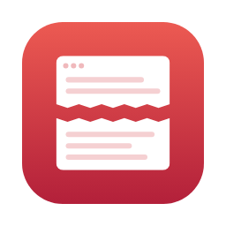
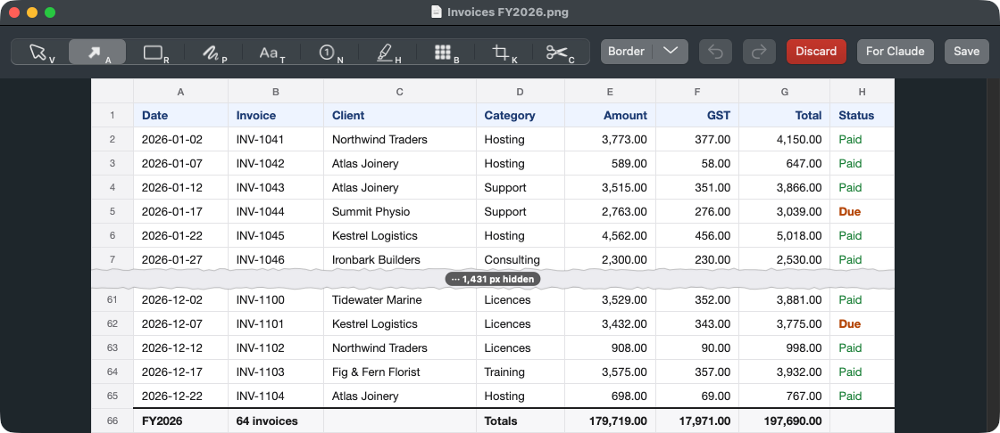
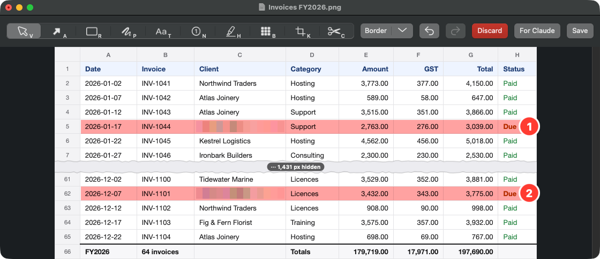

# Excerpt

[](https://github.com/lockyc/excerpt/releases/latest)


[](LICENSE)

A macOS screenshot tool that can **cut the middle out of a screenshot**. Keep a spreadsheet's
header rows and its totals, drop the thousand rows between, and the join is marked with a torn
seam. It works across columns too, and on long scrolling captures of web pages and forms.



It also does everything you'd expect of a screenshot tool: area, window, fullscreen and
scrolling capture, copying the text out of a capture, an editor for arrows, text and highlights,
and screen recordings small enough for GitHub, Slack and Google Chat, with your shortcuts and
clicks drawn in.

## Install

```bash
curl -fsSL https://raw.githubusercontent.com/lockyc/excerpt/main/install.sh | bash
```

Needs macOS 15 or later. The installer downloads the latest release, checks that it is signed by
Excerpt's developer and notarized by Apple, then installs `/Applications/Excerpt.app` and starts
it in the menu bar. It asks for your password only when `/Applications` isn't writable. Excerpt
then updates itself: it checks daily, and **Check for Updates…** in its menu checks now.

**Uninstall:** quit Excerpt, delete `/Applications/Excerpt.app`, run
`defaults delete com.lockyc.excerpt`, and remove Excerpt from Screen Recording, Accessibility and
Input Monitoring in System Settings → Privacy & Security. Your captures stay where they were saved.

## First run

- **Screen Recording** — the first capture asks for it (System Settings → Privacy & Security →
  Screen & System Audio Recording); reopen Excerpt after granting it.
- **Accessibility** — only for scrolling capture's auto-scroll. Scrolling the region yourself
  doesn't need it.
- **Input Monitoring** — only to draw the shortcuts you press into a recording; without it a
  clip shows clicks only.
- **macOS's own screenshot shortcuts** hold ⌘⇧3 to ⌘⇧5 until you turn them off in System Settings →
  Keyboard → Keyboard Shortcuts → Screenshots, or rebind Excerpt's in its Settings. Excerpt's menu
  flags any shortcut macOS still holds.

## Features

| Default hotkey | Capture |
|---|---|
| ⌘⇧3 | Window |
| ⌘⇧4 | Area (the screen freezes while you select) |
| ⌘⇧5 | Text — OCR and QR codes straight to the clipboard, no file |
| ⌘⇧6 | Select an area, adjust it, then pick area, scrolling, text, window, fullscreen or record from a bar over it |
| ⌘⇧7 | Record — select an area, click a window or press F for the display, then Return; ⌘⇧7 again stops |
| ⌥4 | Recent Captures — your last seven captures in a floating panel: click copies, double-click opens, drag it out, hover to edit |

- **Every capture** is saved to `~/Documents/Screenshots/`, copied to the clipboard and shown as a
  thumbnail with **Edit** and **Close**; clicking the thumbnail opens it. Files older than 30
  days move into `YYYY/MM-Month/` folders, names unchanged. Both are settings.
- **Scrolling capture** stitches as you go; your own scrolling takes over from auto-scroll at any
  point.
- **The editor** keeps the original and your edits in a separate `… original.png`, so a capture
  reopened from Recent Captures is still editable. Cut and blurred content never reaches the
  saved file. **Save** (⌘S) saves, copies the image and closes.

  | Tool | Key | What it does |
  |---|---|---|
  | Select | V | Select, move and restyle items; a selected item's colour, size and options float beside it |
  | Arrow | A | An arrow |
  | Rectangle | R | A rectangle outline |
  | Path | P | Click or freehand lines and outlines, optionally filled |
  | Text | T | Plain or on a background of its colour, any size, bold, Sans, Mono or Serif; placed on the capture's own text, it matches that text's size, weight, font and colour |
  | Step | N | Numbered markers that carry on across captures edited together |
  | Highlight | H | A translucent highlight over a region |
  | Blur | B | Blurs a region |
  | Patch | E | Conceals text with the colour around it |
  | Replace | X | Patches a recognised line and lets you retype it in the same size, weight and colour |
  | Crop | K | Crops |
  | Cut | C | Drag across rows or columns to remove them; the join becomes a torn seam |

  The colour control's eyedropper samples any colour from the capture. **Border** frames the image
  in a line of your colour and width, outside its edge. Drawing past the edge grows the picture to
  hold it.

  

- **A series.** Captures taken in a row open together from the newest thumbnail's **Edit All**, or
  by choosing several in **Open Capture…**: one editor, a filmstrip along the bottom, `⌘[` / `⌘]`
  between them. Save writes them all and copies every image, in order.
- **Recording** starts after a 3-2-1 countdown. A bar below the area has **Pause**, **Stop** and
  **Discard**. A recording stops at 5 minutes, and is saved as a GIF fitted to GitHub's 10 MB
  limit or as an MP4 (a setting; one too long for the GIF is saved as MP4). The full-resolution
  `… original.mov` is kept beside it. Its **Edit** trims, blurs the whole clip or a span of it,
  turns the drawn shortcuts and clicks on or off, and switches between GIF and MP4.

## Limits

- Capture Text reads side-by-side columns on one background across, line by line, so their text
  interleaves.
- Scrolling capture stops on pages with large animations or video.
- A recording covers one display; a recorded window is the fixed area it covered when you clicked
  it; a recording's blurs stay where they're drawn rather than following moving content.
- Esc cancels a recording only during the countdown. After that it belongs to the app you're
  recording, so **Discard** throws a recording away.

## Status

In use, `0.x`. What's planned: [docs/roadmap.md](docs/roadmap.md).

## Related

[glance](https://github.com/lockyc/glance), the image viewer, hands PNGs to Excerpt's editor with
**E**.

## Development

Needs Xcode or the Command Line Tools with Swift 6, [`just`](https://github.com/casey/just) and
`shellcheck`.

```bash
git clone https://github.com/lockyc/excerpt && cd excerpt
just gate     # shellcheck, format check, build, tests
just run      # build the signed app and launch it
just install  # build, install to /Applications and launch
```

Builds sign with a `Developer ID Application` identity from your keychain; set
`APPLE_SIGNING_IDENTITY` when there is more than one. `APPLE_SIGNING_IDENTITY=- just run` signs ad
hoc, and macOS then asks for Screen Recording again after each rebuild. Architecture, conventions
and the release process: [CLAUDE.md](CLAUDE.md).

## License

MIT — see [LICENSE](LICENSE).
